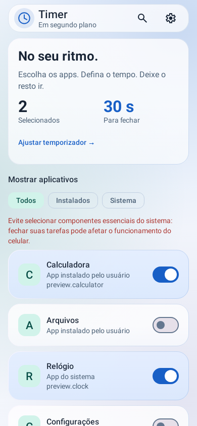
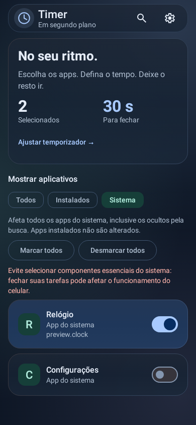
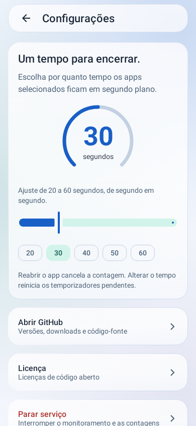
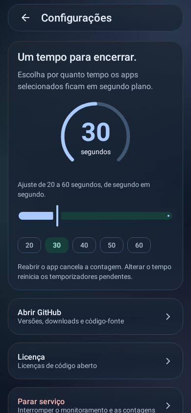

# OnStop2FinishAndRemoveTask Timer

Escolha os aplicativos que deseja monitorar e defina um tempo para remover suas tarefas após eles irem para segundo plano.

> **Timer 4 Glass alternativa:** temporizador de **20 a 60 segundos**, seleção em massa por categoria e interface Material 3 inspirada em Liquid Glass. Esta versão é baseada na Timer 3 e não contém os recursos posteriores do OnTimer.

[**Baixar o APK**](https://github.com/stephansantos250-spec/OnStop2FinishAndRemoveTask-Timer/releases/download/v2.0.6-timer.4-glass.2/OnStopTimer-20-a-60-segundos.apk) · [Ver release e código-fonte](https://github.com/stephansantos250-spec/OnStop2FinishAndRemoveTask-Timer/releases/tag/v2.0.6-timer.4-glass.2) · [Todas as versões](https://github.com/stephansantos250-spec/OnStop2FinishAndRemoveTask-Timer/releases)

**Requisitos:** Android 12 ou superior e [Shizuku](https://shizuku.rikka.app/) instalado, iniciado e autorizado. A compilação e 33 testes automatizados passaram; **ainda não houve teste em celular ou emulador com Shizuku**.

## Conheça o aplicativo

- **Seu tempo:** escolha de 20 a 60 segundos, com ajuste de 1 em 1 segundo e atalhos para 20, 30, 40, 50 e 60 segundos.
- **Sua lista:** escolha apps individualmente e filtre entre **Todos**, **Instalados** e **Sistema**. A busca aceita nome do app, nome do pacote e filtro de selecionados.
- **Seleção por categoria:** marque ou desmarque todos os apps instalados ou do sistema separadamente, sem alterar a outra categoria. A ação também inclui apps ocultos pela busca; a aba **Todos** não tem seleção em massa.
- **Visual Glass:** cartões translúcidos, gradientes estáticos, tema claro e escuro, usando Material 3 e Jetpack Compose.
- **Controle:** reabrir um app cancela sua contagem; parar o serviço interrompe o monitoramento e as contagens.

## Imagens do aplicativo

Prévias da **Timer 4 Glass de 20 a 60 segundos**, renderizadas em testes com aplicativos fictícios. Não são capturas de um dispositivo real.

| Tela inicial · tema claro | Apps do sistema · tema escuro |
| :---: | :---: |
|  |  |
| **Configurações · tema claro** | **Configurações · tema escuro** |
|  |  |

## Primeiros passos

1. Instale e inicie o [Shizuku](https://shizuku.rikka.app/).
2. Baixe e instale o [APK da Timer 4 Glass](https://github.com/stephansantos250-spec/OnStop2FinishAndRemoveTask-Timer/releases/download/v2.0.6-timer.4-glass.2/OnStopTimer-20-a-60-segundos.apk). Permita a instalação de fontes desconhecidas se o Android solicitar.
3. Abra o Timer e conceda a permissão solicitada pelo Shizuku. O serviço inicia após a autorização.
4. Marque os apps desejados. Em **Instalados** ou **Sistema**, os botões de seleção em massa atuam somente na categoria escolhida.
5. Abra **Configurações** e ajuste o temporizador. Ao deixar um app selecionado em segundo plano, sua contagem começa.

> **Atenção:** não selecione componentes essenciais do sistema, como a interface do sistema ou a tela inicial. A remoção de tarefas pode afetar a navegação. Evite deixar os serviços de versões diferentes do app ativos ao mesmo tempo.

## Atualização e compatibilidade

O APK de 20–60 segundos pode atualizar a pré-release Timer 4 Glass alternativa anterior, pois usa a mesma chave. Ele **não atualiza diretamente o OnTimer nem outras releases assinadas com outra chave**. Desinstalar uma versão existente pode apagar configurações e seleções; faça backup antes. Em uma atualização compatível, tempos acima de 1 minuto passam a 60 segundos e as seleções são preservadas.

## Downloads e versões

| Versão | Novidades | Downloads |
| --- | --- | --- |
| **Timer 4 Glass — 20 a 60 segundos** — `2.0.6-timer.4-glass.2` | Ajuste de segundo em segundo e atalhos de tempo | [Release 20 a 60 segundos](https://github.com/stephansantos250-spec/OnStop2FinishAndRemoveTask-Timer/releases/tag/v2.0.6-timer.4-glass.2) |
| **Timer 4 Glass (alternativo)** — `2.0.6-timer.4-glass` | Seleção em massa por categoria e visual Material 3 aprimorado; APK com assinatura diferente | [Pré-release Timer 4 Glass](https://github.com/stephansantos250-spec/OnStop2FinishAndRemoveTask-Timer/releases/tag/v2.0.6-timer.4-glass-alternativo) |
| **OnTimer** — `2.0.6-timer.8` | Versão mais recente, com temas e temporizador de 30 segundos a 5 minutos | [Release OnTimer](https://github.com/stephansantos250-spec/OnStop2FinishAndRemoveTask-Timer/releases/tag/v2.0.6-timer.8) |
| **Timer 3 Glass** — `2.0.6-timer.3` | Interface Material 3 com vidro, temas claro/escuro, animações e otimizações | [Release Timer 3](https://github.com/stephansantos250-spec/OnStop2FinishAndRemoveTask-Timer/releases/tag/v2.0.6-timer.3) |
| **Timer 2** — `2.0.6-timer.2` | Timer de 1–5 min; filtros **Todos / Instalados / Sistema**; identificação do tipo de app | [Release Timer 2](https://github.com/stephansantos250-spec/OnStop2FinishAndRemoveTask-Timer/releases/tag/v2.0.6-timer.2) |
| **Timer 1** — `2.0.6-timer` | Timer de 1–5 min; cancelamento ao reabrir; configuração salva | [Release Timer 1](https://github.com/stephansantos250-spec/OnStop2FinishAndRemoveTask-Timer/releases/tag/v2.0.6-timer) |

As releases disponibilizam APKs e detalhes de cada versão. A release Timer 4 Glass de 20 a 60 segundos também inclui um ZIP com o código-fonte correspondente e as somas SHA-256. O ramo `main` contém o código da versão **Timer 4 Glass alternativa** (`2.0.6-timer.4-glass.2`), baseada na Timer 3, e não inclui os recursos posteriores do OnTimer. Para o código do OnTimer, use o ZIP anexado à sua release; os arquivos automáticos de código dessa tag não correspondem ao OnTimer. As tags preservam os estados anteriores do ramo. O APK Timer 4 Glass atual usa a mesma chave da pré-release Timer 4 Glass alternativa anterior, mas uma chave diferente do OnTimer e de outras releases; leia [LEIA-ESTA-VERSAO.md](LEIA-ESTA-VERSAO.md).

## Interface Glass — Timer 4

Interface nativa de **Material 3 / Jetpack Compose**, com visual inspirado em Liquid Glass: barra e cartões translúcidos, gradientes estáticos, temas claro/escuro, transições curtas e seletor circular de 20 a 60 segundos.

A consulta de nomes e metadados dos apps foi movida para IO e compartilhada no ViewModel; ícones são carregados fora da thread da interface e redimensionados. As gravações de seleção agora são atômicas, evitando perda de escolhas em cliques rápidos.

Para manter o visual leve, não há blur/refração em tempo real nem animações decorativas contínuas. Não foi feito benchmark físico de FPS, bateria ou memória. Material 3 é a base Android; “Liquid Glass” é uma inspiração visual, não um framework da Apple ou integração de shaders MaterialX.

**Validação:** a compilação de release e 33 testes automatizados passaram. Telas com apps fictícios foram renderizadas em Robolectric; ainda é necessário testar em celular com Shizuku.

As prévias das versões anteriores continuam em [docs/previews](docs/previews).

## Funcionamento

- Ao trocar de um app selecionado para outro app ou para a tela inicial, começa a contagem da tarefa anterior.
- Reabrir o mesmo app cancela seu fechamento pendente; sair novamente inicia uma contagem completa.
- Desmarcar um app, remover sua tarefa ou parar o serviço cancela a contagem correspondente.
- Alterar o prazo reinicia as contagens pendentes com o novo tempo.
- Nas versões Timer 2 em diante, os filtros de categoria mudam somente a lista exibida; não apagam as seleções.
- Na Timer 4, nas abas **Instalados** e **Sistema**, use **Marcar todos** ou **Desmarcar todos** para alterar apenas aquela categoria, inclusive apps ocultos pela busca. Na aba **Todos** não há seleção em massa. Marcar todos os apps do sistema pede confirmação, pois pode incluir componentes essenciais.

## Limites e cuidados

O app usa `removeTask` por meio do Shizuku: **remove tarefas/Activities, mas não equivale a “Forçar parada” de todos os processos e serviços**. Componentes sem uma tarefa de interface não passam a ser encerrados por aparecerem na lista.

Evite selecionar componentes essenciais do sistema, como a interface do sistema e a tela inicial. Fechar suas tarefas pode prejudicar a navegação.

As contagens ficam em memória e são canceladas ao encerrar o serviço/processo ou reiniciar o celular. Suspensão, Doze e restrições do fabricante podem atrasar a execução. A compilação e os testes automatizados passaram, mas **não houve teste em celular ou emulador com Shizuku**.

## Compilar

Abra no Android Studio atualizado ou use **JDK 21**, **Android SDK 37.0** e **Build Tools 37.0.0**:

```sh
bash gradlew :app:testDebugUnitTest :app:assembleRelease
```

A saída release sem assinatura fica em `app/build/outputs/apk/release/`. Para instalar uma compilação própria, assine-a com sua própria chave. As chaves privadas usadas nos APKs publicados **não fazem parte do repositório**.

Leia `TEMPORIZADOR.md`, `VALIDACAO_ANDROID.txt`, `APP_FILTROS.md` e `INTERFACE_GLASS.md`.

## Créditos e licença

- Autor do projeto original: [takusan23](https://github.com/takusan23).
- Projeto original: [OnStop2FinishAndRemoveTask](https://github.com/takusan23/OnStop2FinishAndRemoveTask).
- Base das modificações: commit `ea535cd546a96722cdfda906508b667de7f81ecb`.
- Licença: **Apache-2.0** — veja [LICENSE](LICENSE) e [NOTICE](NOTICE).
- O README original foi preservado em [docs/README-upstream.md](docs/README-upstream.md).
